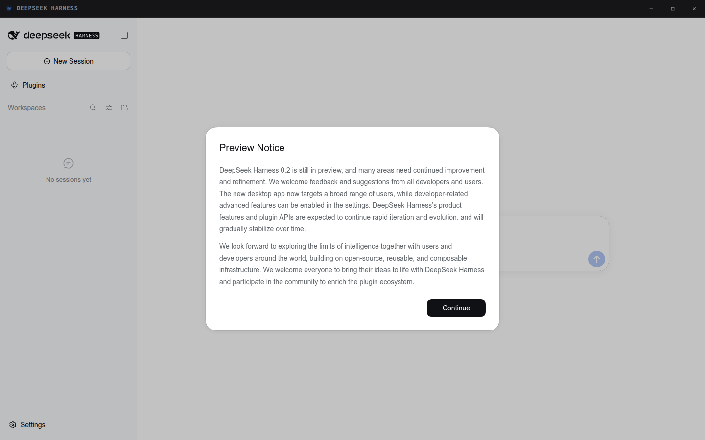
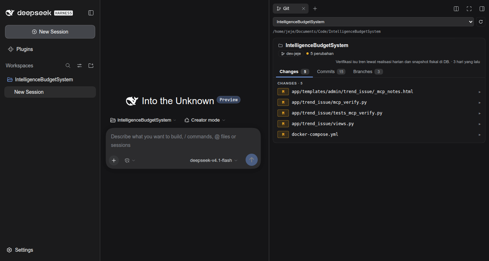

# DSH Headless Desktop for Linux

**DeepSeek Harness sebagai jendela desktop sungguhan di Linux — tanpa header OS,
tombol jendela digambar di dalam aplikasi.**

GUI web DSH biasanya jalan di tab browser: ada title bar GNOME, strip tab, dan
address bar yang tidak pernah dipakai. Paket ini membungkusnya jadi jendela
Electron frameless, dan menaruh tombol yang benar-benar Anda butuhkan
(minimize / maximize / close) di dalam jendela.

[English →](README.md)



---

## Yang Anda dapat

- **Jendela frameless.** Tanpa title bar OS, tanpa tab, tanpa address bar. Strip
  tipis 36px memuat nama aplikasi dan tiga tombol jendela.
- **Halaman DSH tidak diubah.** GUI dirender di `WebContentsView` sendiri di
  bawah strip, jadi tidak ada kontrol DSH yang tertutup window chrome.
- **Resize tepi yang benar-benar bekerja.** Jendela frameless tidak dapat handle
  resize native di Linux, jadi ada handle transparan di tepi yang meneruskan
  drag ke jendela.
- **Strip mengikuti tema.** Strip mengikuti tema **halaman DSH** (Settings →
  Appearance), bukan tema OS, jadi tidak pernah belang.
- **Fallback yang masuk akal.** Wayland → X11 → Chrome `--app`, berurutan. Anda
  selalu dapat jendela, walau Electron gagal start.
- **Server ikut jendela.** Menutup jendela mematikan server DSH yang ia
  nyalakan. Membuka lagi memakai ulang server yang masih hidup.
- **Satu perintah untuk memasang.** `dsh-desktop install` menulis launcher,
  ikon, dan entri menu aplikasi.

### Ikut dalam repo ini: tab Git untuk sidebar kanan

`packages/dsh-git-tab` adalah penampil Git read-only yang hidup **sebagai tab di
sidebar kanan DSH**, sejajar dengan Files dan Terminal. Repository, branch,
perubahan working tree, diff berwarna, commit.



---

## Kebutuhan

| | |
|---|---|
| OS | Linux (Wayland atau X11) |
| Node.js | **20 atau lebih baru** |
| DeepSeek Harness | `0.2.x` — `npm i -g @deepseek-ai/dsh` |
| Compositor | Apa saja. GNOME, KDE, Hyprland, Sway |
| Disk | ~350 MB untuk runtime Electron |

Periksa mesin Anda dulu — ini menangkap hampir semua masalah sebelum Anda
melihat jendela kosong:

```bash
npx dsh-headless-desktop-for-linux doctor
```

---

## Instalasi

### Coba dulu tanpa memasang (npx)

```bash
npx dsh-headless-desktop-for-linux
```

Cocok untuk melihat pertama kali. Electron dan runtime ~275 MB diunduh saat
pertama dijalankan.

### Pasang permanen (disarankan)

```bash
npm install -g dsh-headless-desktop-for-linux
dsh-desktop install
```

`install` menaruh launcher di `~/.local/bin`, ikon di
`~/.local/share/icons/hicolor`, dan entri di `~/.local/share/applications`.
Setelah itu **DSH Desktop** muncul di menu aplikasi, dan `dsh-desktop` bisa
dipanggil dari terminal mana pun.

Sekalian pasang tab Git:

```bash
dsh-desktop install --with-git-plugin
```

Lalu restart DSH sepenuhnya agar bundle dimuat.

### Pakai

```bash
dsh-desktop                       # buka jendela
dsh-desktop --window app          # jendela Chrome --app (title bar OS)
dsh-desktop --size 1280x800       # ukuran jendela
dsh-desktop --profile myprofile   # profil DSH lain
dsh-desktop --maximized
dsh-desktop uninstall             # cabut semua yang dipasang
```

Daftar opsi lengkap: `dsh-desktop --help`.

---

## Tab Git

Panel Git adalah paket terpisah supaya Anda bisa memakai desktop shell tanpa
Git, atau Git tanpa desktop shell.

```bash
# lewat DSH
dsh plugin --profile web add dsh-git-tab

# atau dari halaman plugin: Plugins → Add plugin → dsh-git-tab
```

Restart DSH, buka sidebar kanan, pilih **Git** di halaman guide.

**Cara root dipilih.** Tab ini terikat ke Session-nya sendiri, jadi root default
adalah workspace pemilik Session itu, lalu `cwd` Session, lalu workspace pertama
yang terdaftar. Dua Session di workspace berbeda menampilkan repo berbeda.
Dropdown mengganti root dan langsung memindai ulang.

**Cara repository ditemukan.** Workspace tidak harus berupa repository. Ia
memindai hingga tiga level di bawah root, dan setiap checkout yang ditemukan
menjadi kartu sendiri dengan `relPath` yang menunjukkan posisinya.
`node_modules`, `dist`, `.venv`, dan sejenisnya dilewati.

**Read-only menurut desain.** Hanya branch, status, log, `git show`, dan diff.
Tidak ada route tulis. Output diff dibatasi (400 KB / 1600 baris) supaya
perubahan besar hasil vendoring tidak mengunci panel.

---

## Konfigurasi

Buat `~/.config/dsh-desktop/config.env`. Semua nilai opsional.

```bash
# Jendela: shell (frameless, default) | app (Chrome) | browser (tab)
DSH_WEB_APP_WINDOW=shell

DSH_WEB_APP_PROFILE=web        # profil DSH
DSH_WEB_APP_PORT=3080          # 0 = biarkan OS memilih port kosong
DSH_WEB_APP_SIZE=1440,900
DSH_WEB_APP_MAXIMIZED=0
DSH_WEB_APP_DEBUG=0            # 1 = log launcher ke stderr

# Path kustom (jarang perlu)
# DSH_WEB_APP_DSH_BIN=/path/to/dsh
# DSH_WEB_APP_BROWSER=/usr/bin/google-chrome-stable
# DSH_WEB_APP_BROWSER=/path/to/electron    # override runtime Electron
```

Flag command line menimpa file ini.

### Lokasi berkas

```
~/.config/dsh-desktop/config.env        # konfigurasi Anda
~/.local/state/dsh-desktop/             # dsh-desktop.log, server.log
/run/user/<uid>/dsh-desktop/            # pid + URL server (sementara)
~/.local/share/applications/dsh-desktop.desktop
~/.local/share/icons/hicolor/*/apps/dsh-desktop.png
~/.local/bin/dsh-desktop
```

---

## Keyboard dan mouse

| | |
|---|---|
| Drag strip | Pindahkan jendela |
| Dobel-klik strip | Maximize / restore |
| Drag tepi atau sudut | Resize |
| `F11` | Fullscreen |
| `Ctrl+Shift+I` | DevTools (hanya dengan `--devtools`) |

---

## Pemecahan masalah

### `dsh-desktop doctor` dulu

Ia memeriksa Node, `dsh`, binary Electron, sandbox Chromium, dan tipe sesi, lalu
memberi tahu mana yang rusak.

### Jendela kosong atau tidak muncul

Jalankan dengan `--debug` dan baca log:

```bash
dsh-desktop --debug
tail -40 ~/.local/state/dsh-desktop/dsh-desktop.log
tail -40 ~/.local/state/dsh-desktop/server.log
```

### Electron langsung keluar di sesi Wayland

Launcher sudah otomatis mencoba X11. Kalau keduanya gagal, ia jatuh ke jendela
Chrome `--app`, yang punya title bar OS tetapi tetap bekerja. Untuk memaksa satu
backend:

```bash
DSH_WEB_APP_WINDOW=app dsh-desktop
```

### `The SUID sandbox helper binary was found, but is not configured correctly`

`chrome-sandbox` milik Electron harus dimiliki root dengan mode `4755`. Instalasi
npm biasa tidak bisa melakukan itu, jadi launcher mendeteksinya dan menambahkan
`--no-sandbox` otomatis. `doctor` menunjukkan mode mana yang aktif. Lihat
[Keamanan](#keamanan) untuk artinya.

### `npm i -g` sukses tapi `dsh-desktop` tidak ditemukan

`~/.local/bin` kemungkinan tidak ada di `PATH`. Tambahkan:

```bash
echo 'export PATH="$HOME/.local/bin:$PATH"' >> ~/.bashrc && exec bash
```

Atau jalankan lewat npx: `npx dsh-headless-desktop-for-linux`.

### Tab Git tidak muncul

1. Restart DSH sepenuhnya — bundle dimuat saat startup.
2. Pastikan terdaftar: `dsh plugin --profile web list | grep git-tab`.
3. Tab ini butuh **Session**. Tanpa Session terpilih tidak ada sidebar kanan
   untuk dibuka, jadi tab tidak punya tempat.
4. Pastikan versi DSH: `dsh --version` harus `0.2.x`.

### Unduhan Electron lambat atau diblokir

Arahkan installer ke mirror sebelum `npm install`:

```bash
export ELECTRON_MIRROR="https://npmmirror.com/mirrors/electron/"
npm install -g dsh-headless-desktop-for-linux
```

---

## Keamanan

Dua hal perlu dipahami.

**`--no-sandbox`.** Sandbox Chromium butuh helper SUID milik root
(`chrome-sandbox`). Instalasi npm biasa tidak bisa membuatnya, jadi launcher
menambahkan `--no-sandbox` saat mendeteksi helper tidak siap. Renderer tetap
berjalan dengan `contextIsolation: true`, `sandbox: true`, dan tanpa akses Node;
halaman yang disajikan adalah GUI DSH lokal Anda sendiri. Kalau Anda ingin
sandbox Chromium aktif, perbaiki helper-nya sendiri (milik root, mode 4755) dan
`doctor` akan melaporkan `SUID aktif`.

**Tidak ada Node di halaman.** Halaman DSH hanya mendapat satu jembatan,
`window.dshShell`, yang mengekspos minimize / maximize / close dan status
jendela. Tidak ada `fs`, tidak ada `ipcRenderer`, tidak ada IPC bebas. Tautan
keluar dibuka di browser default, bukan di dalam shell.

---

## Struktur paket

```
dsh-headless-desktop-for-linux/
├── bin/dsh-desktop.mjs      CLI: start / install / uninstall / doctor
├── shell/                   Aplikasi Electron (CommonJS — lihat shell/package.json)
│   ├── main.js              jendela, tata letak strip, IPC, resize
│   ├── shell.html           strip judul, tombol, token tema
│   ├── shell-preload.js     jembatan untuk strip
│   └── view-preload.js      jembatan untuk halaman DSH + handle tepi
├── launcher/dsh-web-app     launcher bash: siklus server + rantai jendela
├── desktop/                 template .desktop (path diisi saat install)
├── icons/                   16…512px + SVG
└── packages/dsh-git-tab/    bundle tab Git (host + client)
```

---

## Pengembangan

```bash
git clone https://github.com/jejeprananda/dsh-headless-desktop-for-linux
cd dsh-headless-desktop-for-linux
npm install
node bin/dsh-desktop.mjs doctor
node bin/dsh-desktop.mjs start --debug
```

Untuk mengerjakan tab Git, pasang ke profil DSH lalu restart:

```bash
dsh plugin --profile web add "$PWD/packages/dsh-git-tab"
```

**Dua aturan yang akan menggigit kalau dilanggar:**

1. `shell/package.json` **tidak boleh** memuat `"type": "module"`. Manifest root
   memakai ESM untuk CLI; berkas di folder shell adalah CommonJS yang dimuat
   Electron. Berkas itulah yang memisahkan keduanya.
2. `client.js` mendaftar dengan `id: "dsh-git-tab"`. Id modul harus sama dengan
   nama paket, kalau tidak half browser tidak pernah dimuat dan tab tidak muncul
   tanpa pesan.

---

## Publikasi (maintainer)

```bash
npm pack --dry-run                    # periksa isi tarball
npm publish                           # paket desktop
npm publish -w packages/dsh-git-tab   # paket plugin
```

`publishConfig.registry` mengunci ke registry publik, jadi setelan mirror lokal
tidak bisa mengirimnya ke tempat lain. Naikkan versi keduanya bersamaan bila
shell dan plugin berubah sekaligus.

---

## Lisensi

MIT © Jeje Prananda. Lihat [LICENSE](LICENSE).

Tidak berafiliasi dengan DeepSeek. DeepSeek Harness adalah proyek tersendiri.
