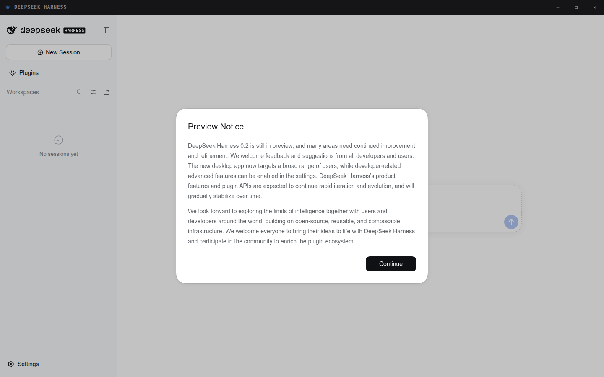
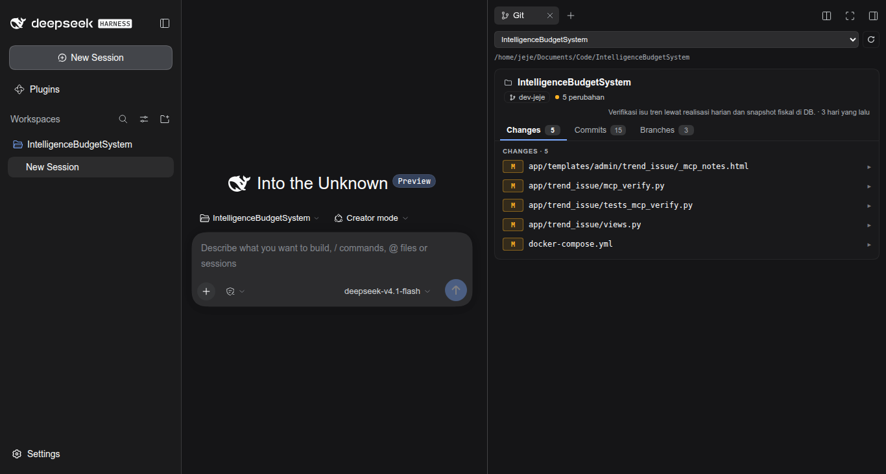

# DSH Headless Desktop for Linux

**DeepSeek Harness as a real desktop window on Linux — no OS title bar, window
controls drawn inside the app.**

The DSH web GUI normally runs in a browser tab, where you get a GNOME title bar,
a tab strip, and an address bar you never use. This package wraps it in a
frameless Electron window instead, and keeps the buttons you actually need
(minimize / maximize / close) inside the window itself.

[Bahasa Indonesia →](README.id.md)



---

## What you get

- **Frameless window.** No OS title bar, no tabs, no address bar. A slim 36px
  strip carries the app name and the three window buttons.
- **The DSH page is untouched.** The GUI renders in its own `WebContentsView`
  below the strip, so no DSH control is ever covered by window chrome.
- **Edge resize that actually works.** Frameless windows don't get native resize
  handles on Linux, so transparent edge handles relay drags to the window.
- **Theme-aware strip.** The strip follows the theme **the DSH page** is using
  (Settings → Appearance), not the OS theme, so it never clashes.
- **Sensible fallbacks.** Wayland → X11 → plain Chrome `--app`, in that order.
  You always get a window, even if Electron can't start.
- **Server follows the window.** Closing the window stops the DSH server it
  started. Reopening reuses a server that is still running.
- **One command to install.** `dsh-desktop install` writes the launcher, icons,
  and application-menu entry.

### Also in this repo: a Git tab for the right sidebar

`packages/dsh-git-tab` is a read-only Git viewer that lives **as a tab in DSH's
right sidebar**, next to Files and Terminal. Repositories, branches, working-tree
changes, coloured diffs, commits.



---

## Requirements

| | |
|---|---|
| OS | Linux (Wayland or X11) |
| Node.js | **20 or newer** |
| DeepSeek Harness | `0.2.x` — `npm i -g @deepseek-ai/dsh` |
| Compositor | Any. GNOME, KDE, Hyprland, Sway all work |
| Disk | ~350 MB for the Electron runtime |

Verify your machine first — this catches almost every problem before you see a
blank window:

```bash
npx dsh-headless-desktop-for-linux doctor
```

---

## Install

### Try it without installing (npx)

```bash
npx dsh-headless-desktop-for-linux
```

Good for a first look. Electron and its ~275 MB runtime download on first run.

### Install it properly (recommended)

```bash
npm install -g dsh-headless-desktop-for-linux
dsh-desktop install
```

`install` places the launcher in `~/.local/bin`, icons in
`~/.local/share/icons/hicolor`, and an entry in `~/.local/share/applications`.
After that, **DSH Desktop** shows up in your application menu, and `dsh-desktop`
works from any terminal.

To wire up the Git tab at the same time:

```bash
dsh-desktop install --with-git-plugin
```

Then fully restart DSH so the bundle loads.

### Use it

```bash
dsh-desktop                       # open the window
dsh-desktop --window app          # Chrome --app window instead (OS title bar)
dsh-desktop --size 1280x800       # window size
dsh-desktop --profile myprofile   # a different DSH profile
dsh-desktop --maximized
dsh-desktop uninstall             # remove everything it installed
```

Full option list: `dsh-desktop --help`.

---

## The Git tab

The Git panel is a separate package so you can use it without the desktop shell,
or the desktop shell without Git.

```bash
# via DSH itself
dsh plugin --profile web add dsh-git-tab

# or from the plugin page: Plugins → Add plugin → dsh-git-tab
```

Restart DSH, then open the right sidebar and pick **Git** from the guide page.

**How the root is chosen.** The tab is scoped to its own session, so the root
defaults to the workspace owning that session, then that session's `cwd`, then
the first registered workspace. Two sessions on different workspaces show
different repositories. The dropdown switches root and rescans immediately.

**How repositories are found.** A workspace does not need to be a repository. It
scans up to three levels below the root, and every checkout it finds becomes its
own card with `relPath` showing its position. `node_modules`, `dist`, `.venv`,
and similar directories are skipped.

**Read-only by design.** Branch, status, log, `git show`, and diff only. There
are no write routes. Diff output is capped (400 KB / 1600 lines) so a huge
vendored change cannot lock the panel.

---

## Configuration

Create `~/.config/dsh-desktop/config.env`. Every value is optional.

```bash
# Jendela: shell (frameless, default) | app (Chrome) | browser (tab)
DSH_WEB_APP_WINDOW=shell

DSH_WEB_APP_PROFILE=web        # profil DSH
DSH_WEB_APP_PORT=3080          # 0 = biarkan OS memilih port kosong
DSH_WEB_APP_SIZE=1440,900
DSH_WEB_APP_MAXIMIZED=0
DSH_WEB_APP_DEBUG=0            # 1 = log launcher ke stderr

# Path kustom (jarang perlu)
# DSH_WEB_APP_DSH_BIN=/path/to/dsh
# DSH_WEB_APP_BROWSER=/usr/bin/google-chrome-stable
# DSH_WEB_APP_BROWSER=/path/to/electron    # override runtime Electron
```

Command-line flags override this file.

### Where things live

```
~/.config/dsh-desktop/config.env        # konfigurasi Anda
~/.local/state/dsh-desktop/             # dsh-desktop.log, server.log
/run/user/<uid>/dsh-desktop/            # pid + URL server (sementara)
~/.local/share/applications/dsh-desktop.desktop
~/.local/share/icons/hicolor/*/apps/dsh-desktop.png
~/.local/bin/dsh-desktop
```

---

## Keyboard and mouse

| | |
|---|---|
| Drag the strip | Move the window |
| Double-click the strip | Maximize / restore |
| Drag any edge or corner | Resize |
| `F11` | Fullscreen |
| `Ctrl+Shift+I` | DevTools (only with `--devtools`) |

---

## Troubleshooting

### `dsh-desktop doctor` first

It checks Node, `dsh`, the Electron binary, the Chromium sandbox, and your
session type, and tells you which one is broken.

### The window is blank or never appears

Run with `--debug` and read the log:

```bash
dsh-desktop --debug
tail -40 ~/.local/state/dsh-desktop/dsh-desktop.log
tail -40 ~/.local/state/dsh-desktop/server.log
```

### Electron exits immediately on a Wayland session

The launcher already retries with X11 automatically. If both fail it falls back
to a Chrome `--app` window, which has an OS title bar but still works. To force
one backend:

```bash
DSH_WEB_APP_WINDOW=app dsh-desktop
```

### `The SUID sandbox helper binary was found, but is not configured correctly`

Electron's `chrome-sandbox` must be owned by root with mode `4755`. Most npm
installs cannot do that, so the launcher detects it and passes `--no-sandbox`
automatically. `doctor` shows which mode you are in. See
[Security](#security) for what that means.

### `npm i -g` succeeded but `dsh-desktop` is not found

`~/.local/bin` is probably not on your `PATH`. Add it:

```bash
echo 'export PATH="$HOME/.local/bin:$PATH"' >> ~/.bashrc && exec bash
```

Or run it through npx: `npx dsh-headless-desktop-for-linux`.

### The Git tab does not appear

1. Restart DSH fully — bundles load at startup.
2. Check it is registered: `dsh plugin --profile web list | grep git-tab`.
3. The tab needs a **session**. With no session selected there is no right
   sidebar to open, so the tab has nowhere to go.
4. Confirm the DSH version: `dsh --version` must be `0.2.x`.

### Downloading Electron is slow or blocked

Point the installer at a mirror before `npm install`:

```bash
export ELECTRON_MIRROR="https://npmmirror.com/mirrors/electron/"
npm install -g dsh-headless-desktop-for-linux
```

---

## Security

Two things are worth understanding.

**`--no-sandbox`.** Chromium's sandbox needs a root-owned SUID helper
(`chrome-sandbox`). A normal npm install cannot create one, so the launcher adds
`--no-sandbox` when it detects the helper is not set up correctly. The renderer
still runs with `contextIsolation: true`, `sandbox: true`, and no Node access;
the page served is your own local DSH GUI. If you want the Chromium sandbox
active, fix the helper yourself (root-owned, mode 4755) and `doctor` will report
`SUID aktif`.

**No Node in the page.** The DSH page gets exactly one bridge, `window.dshShell`,
exposing minimize / maximize / close and the window state. There is no `fs`, no
`ipcRenderer`, no arbitrary IPC. Outbound links open in your default browser,
not inside the shell.

---

## Package layout

```
dsh-headless-desktop-for-linux/
├── bin/dsh-desktop.mjs      CLI: start / install / uninstall / doctor
├── shell/                   Electron app (CommonJS — see shell/package.json)
│   ├── main.js              window, strip layout, IPC, resize
│   ├── shell.html           title strip, buttons, theme tokens
│   ├── shell-preload.js     bridge for the strip
│   └── view-preload.js      bridge for the DSH page + edge handles
├── launcher/dsh-web-app     bash launcher: server lifecycle + window chain
├── desktop/                 .desktop template (paths filled at install)
├── icons/                   16…512px + SVG
└── packages/dsh-git-tab/    Git tab bundle (host + client)
```

---

## Development

```bash
git clone https://github.com/jejeprananda/dsh-headless-desktop-for-linux
cd dsh-headless-desktop-for-linux
npm install
node bin/dsh-desktop.mjs doctor
node bin/dsh-desktop.mjs start --debug
```

To work on the Git tab, install it into a DSH profile and restart:

```bash
dsh plugin --profile web add "$PWD/packages/dsh-git-tab"
```

**Two rules that will bite you if broken:**

1. `shell/package.json` must **not** contain `"type": "module"`. The root
   manifest is ESM for the CLI; the shell files are CommonJS loaded by Electron.
   That file is what keeps the two apart.
2. `client.js` registers under `id: "dsh-git-tab"`. The module id must equal the
   package name or the browser half never loads and the tab silently never
   appears.

---

## Publishing (maintainers)

```bash
npm pack --dry-run                # periksa isi tarball
npm publish                       # paket desktop
npm publish -w packages/dsh-git-tab   # paket plugin
```

`publishConfig.registry` pins the public registry, so a local mirror setting
cannot send it elsewhere. Bump both versions together when the shell and the
plugin change at once.

---

## License

MIT © Jeje Prananda. See [LICENSE](LICENSE).

Not affiliated with DeepSeek. DeepSeek Harness is its own project.
