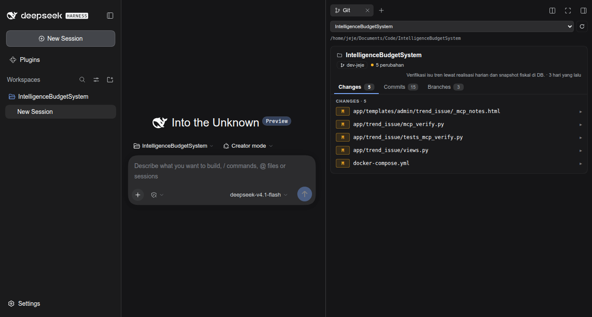
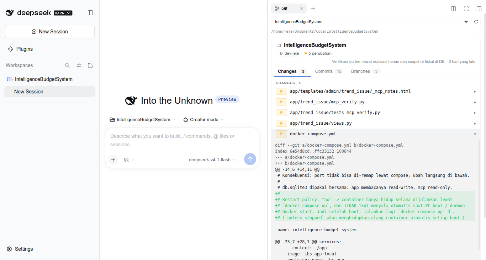

# dsh-git-tab

**Read-only Git tab for the DeepSeek Harness right sidebar.**

Lives beside File Explorer and Terminal. Shows every repository under the
workspace root with its branch, working-tree changes, coloured diffs, recent
commits, and local branches.

Part of [dsh-headless-desktop-for-linux](https://github.com/jejeprananda/dsh-headless-desktop-for-linux).
The Git tab and the desktop window are independent — install either alone.



---

## Install

```bash
dsh plugin --profile web add dsh-git-tab
```

Or in DSH: **Plugins → Add plugin → `dsh-git-tab` → Install**.

**Restart DSH fully** — bundles load at startup, so the tab will not appear in a
running session.

Then open the right sidebar and pick **Git** from the guide page.

Requires DeepSeek Harness `0.2.x`.

---

## What it does

**One card per repository.** A workspace does not need to be a repository. The
tab scans up to three levels below the root, skipping `node_modules`, `dist`,
`build`, `out`, `coverage`, `target`, `vendor`, `.venv`, `.git`, and similar.
Each checkout becomes its own card, with `relPath` showing where it sits.

**Root follows the session.** The tab is scoped to its own session, so it opens
on the workspace that owns that session, then that session's `cwd`, then the
first registered workspace. Two sessions on different workspaces see different
repositories. The dropdown switches root and rescans immediately.

| Tab | Contents |
|---|---|
| **Changes** | Conflicts, Staged, Changes, Untracked. Click a row to expand its diff |
| **Commits** | Recent 15 commits; click for header, stat, and patch |
| **Branches** | Local branches, current one marked `HEAD`, with upstream and age |

**Read-only by design.** Branch, status, log, `git show`, and diff. No write
routes exist, so the tab cannot stage, commit, or discard anything.

**Bounded output.** Diff and patch text is capped at 400 KB / 1600 rendered
lines, so a huge vendored change cannot lock the panel.

---

## Theme

Colours come from DSH theme tokens, not fixed hex values, so the tab reads
correctly in both Light and Dark. Diff lines use `label-primary`,
`label-secondary`, `state-success`, `state-error`, and `brand-primary`; the diff
body background is a `color-mix` of the label colour.



---

## How it works

One package carries both halves; the loader pairs them by package name:

| File | Role |
|---|---|
| `index.js` | Host half — registers `/api/git.repos`, `/api/git.repo`, `/api/git.diff`, `/api/git.show` over Connection Fetch |
| `client.js` | Browser half — registers the tab type, body, and chip title |
| `cordis.patch.yml` | Loader patch that inserts the bundle row |

**Security.** Every route takes the scanned root plus one repository directory
from that scan, and the host re-validates that the repository really sits inside
the root before running any `git` command there. Diff and show output are size
capped before being sent.

**Extension points used:**

- `ctx.sidebarRightTabs.register({ kind: "git", … })` — the tab type and its guide card
- `sidebar.right.pane.tab` — the body
- `sidebar.right.pane.tab.title` — the chip title

The body reads `useWorkspaces` / `useSessions` from the framework-injected
selector hooks, plus `useTabInfo()` for its own tab record.

---

## Troubleshooting

**Tab does not appear**

1. Restart DSH fully; a running session will not pick up the bundle.
2. `dsh plugin --profile web list | grep git-tab` — is it installed?
3. The tab needs a **session**. With no session selected there is no right
   sidebar to open.
4. `dsh --version` must be `0.2.x`.

**"Tidak ada repository Git"**

The workspace root genuinely has no checkout within three levels. Pick another
root from the dropdown, or check that the repository has a `.git` directory
(worktrees and submodules are fine).

**Branches tab is missing**

Older Host builds do not return branch data. Restart DSH against a current
`0.2.x` build.

---

## Development

```bash
git clone https://github.com/jejeprananda/dsh-headless-desktop-for-linux
cd dsh-headless-desktop-for-linux/packages/dsh-git-tab
dsh plugin --profile web add "$PWD"
```

**One rule that will bite you:** `client.js` registers under
`id: "dsh-git-tab"`. The module id must equal the package name, or the browser
half never loads and the tab silently never appears.

## License

MIT © Jeje Prananda.
